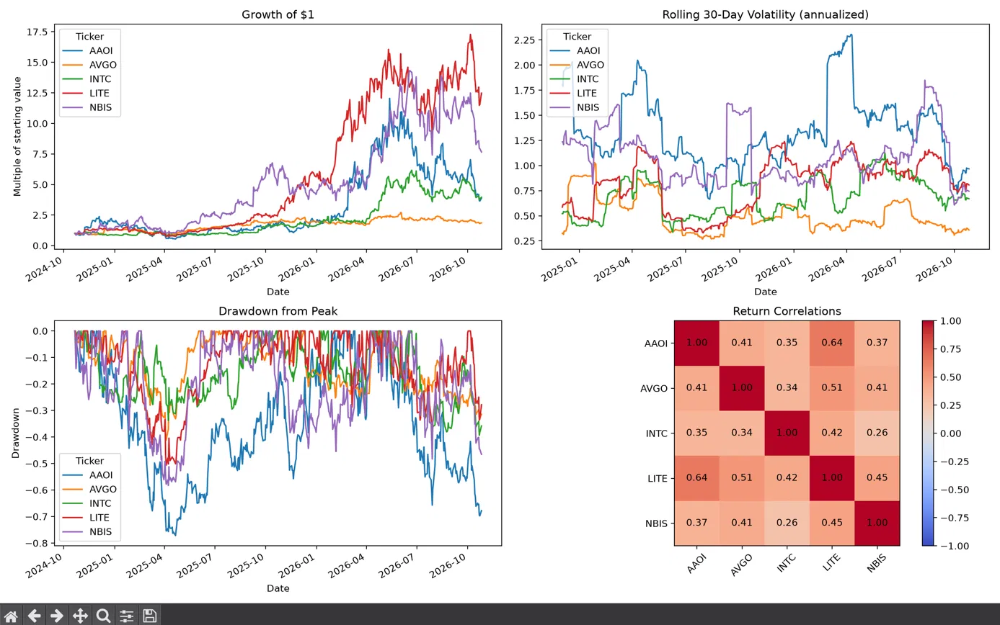

# Stock Data Explorer

A Python tool that downloads historical stock prices and computes the core
statistics quants look at first: returns, volatility, drawdown, Sharpe ratio,
and correlations.


Return correlations scale: Negative 1 -> 1

-1 = They always move in opposite directions
0 = No relationship, so one stock’s move tells you nothing about the other’s
1 = The two stock prices always move in unison




## Features
- Requests user for tickers and time period (or accepts them as command line arguments)
- Annualised return, volatility, and Sharpe ratio
- Max drawdown and a drawdown over time chart
- Rolling 30 day volatility
- Correlation heatmap of daily returns

## Setup
```
python3 -m venv .venv
source .venv/bin/activate
pip install -r requirements.txt
python main.py AAPL MSFT NVDA --years 5
```
Run `python main.py` with no arguments and it will ask for tickers.

## How it works
- **Return:** `pct_change()` on adjusted closing prices
- **Volatility:** standard deviation of daily returns, scaled by √252 to annualise
- **Sharpe ratio:** annualized return divided by annualized volatility (risk-free rate assumed 0)
- **Drawdown:** price divided by its running peak, minus 1
- **Correlation:** computed on daily returns, not prices

## Limitations
- Uses historical data only; past performance does not predict future results
- Results depend heavily on the chosen start date
- Tickers chosen after the fact introduce selection bias

*Educational project, NOT FINANCIAL ADVICE.*
